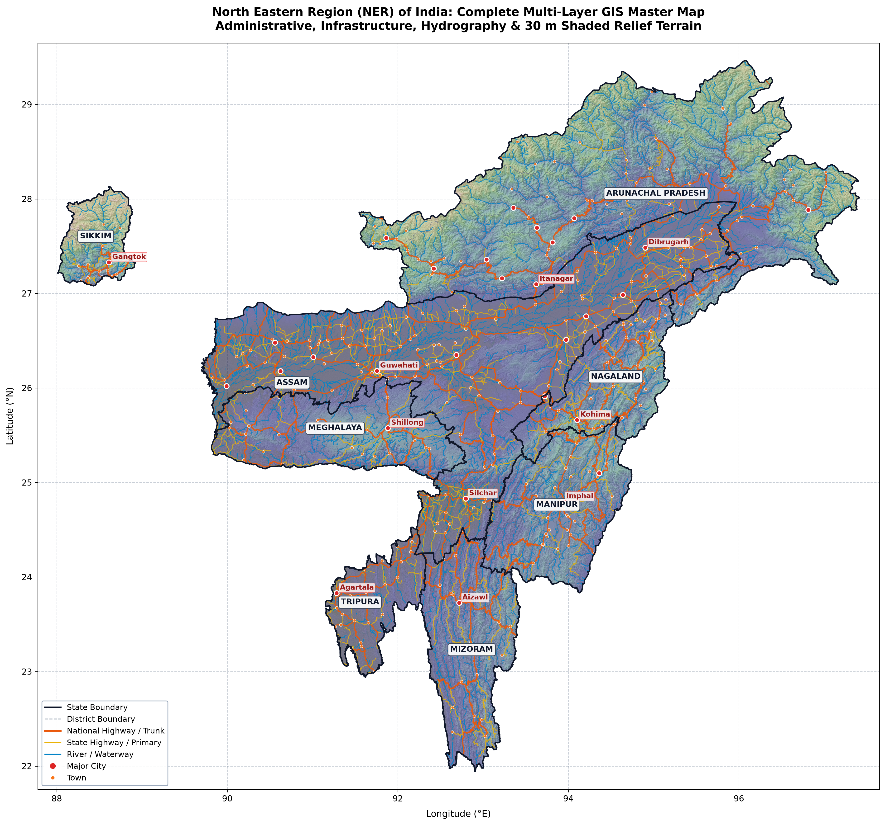

# Northeast India (NER) Open GIS Dataset

<p align="center">
  
</p>

<p align="center">
  <a href="https://github.com/archelleus/ner-gis-data/releases/latest"></a>
  <a href="https://opensource.org/licenses/MIT"></a>
  <a href="https://opendatacommons.org/licenses/odbl/"></a>
  <a href="https://creativecommons.org/licenses/by/4.0/"></a>
  
  
  
</p>

---

## 📌 Overview

The **North Eastern Region (NER) Open GIS Dataset** is a curated, topology-validated, multi-layer geospatial data repository covering all 8 northeastern states of India: **Arunachal Pradesh, Assam, Manipur, Meghalaya, Mizoram, Nagaland, Sikkim, and Tripura**.

### Why This Exists
- **No More Giant Dumps**: Previously, researchers and developers had to download massive 1.5+ GB pan-India OpenStreetMap (OSM) files and raw global DEM archives just to extract Northeast India.
- **Topology-Clean & Validated**: All geometries have been clipped to the official regional bounding box, repaired for self-intersections (`make_valid`), and verified for 100% valid WGS 84 (`EPSG:4326`) compliance.
- **Modern Serverless Web Formats**: Includes an all-in-one **18.6 MB PMTiles** vector archive and Cloud-Optimized GeoTIFF (COG) overlays for instant 60fps web rendering without requiring GeoServer or backend tile daemons.
- **Machine Learning Ready**: Includes tabular spatial join matrices and engineered environmental features (`ner_ml_package`) for disaster risk modeling, landslide vulnerability, and infrastructure accessibility studies.

---

## 🗺️ Dataset Catalog & Summary

| Layer | File / Path | Format | Features / Resolution | Description |
| :--- | :--- | :---: | :---: | :--- |
| **States** | [`data/processed/ner_states.geojson`](data/processed/ner_states.geojson) | GeoJSON | 8 polygons | Standardized state boundaries for all 8 NER states. |
| **Districts** | [`data/processed/ner_districts.geojson`](data/processed/ner_districts.geojson) | GeoJSON | 119 polygons | Complete district boundaries with ISO codes and parent names. |
| **Roads** | [`data/processed/ner_roads.geojson`](data/processed/ner_roads.geojson) | GeoJSON | 13,052 lines | Primary, trunk, secondary, and tertiary road networks. |
| **Rivers** | [`data/processed/ner_rivers.geojson`](data/processed/ner_rivers.geojson) | GeoJSON | 4,155 lines | Hydrographic network including the Brahmaputra & Barak basins. |
| **Settlements** | [`data/processed/ner_settlements.geojson`](data/processed/ner_settlements.geojson) | GeoJSON | 5,918 points | Cities (29), towns (333), and key rural settlements (3,454). |
| **Vector Archive** | [`web/ner_map.pmtiles`](web/ner_map.pmtiles) | PMTiles v3 | 18.6 MB (all layers) | Single serverless tile file for MapLibre, Leaflet, and OpenLayers. |
| **Terrain / DEM** | `terrain/ner_elevation.tif` | GeoTIFF / COG | 30m (~1 arc-sec) | Seamless NASA SRTM Skadi digital elevation model. |
| **Hillshade** | `terrain/ner_hillshade.tif` | GeoTIFF / COG | 30m (~1 arc-sec) | High-contrast shaded relief raster for cartographic basemaps. |
| **Slope** | `terrain/ner_slope.tif` | GeoTIFF / COG | 30m (~1 arc-sec) | Slope incline raster in degrees (0° - 89.1°). |
| **ML Features** | [`ner_ml_package/`](ner_ml_package/) | Parquet & CSV | 5,918 settlements | Engineered features: elevation, slope, distances to roads/rivers. |

> *Detailed field-by-field schema is available in [Master Data Dictionary](web/DATA_DICTIONARY.md).*

---

## 🚀 Quick Start

### 1. Load GeoJSON with Python (GeoPandas)
```python
import geopandas as gpd

# Load districts
districts = gpd.read_file("data/processed/ner_districts.geojson")
print(f"Loaded {len(districts)} districts across {districts['state_name'].nunique()} states.")

# Load road network
roads = gpd.read_file("data/processed/ner_roads.geojson")
print(f"Total road network length: {roads.geometry.length.sum():.2f} degrees")
```

### 2. Stream Vector Tiles in MapLibre GL JS (No Server Required)
```html
<link href="https://unpkg.com/maplibre-gl@3.6.2/dist/maplibre-gl.css" rel="stylesheet" />
<script src="https://unpkg.com/maplibre-gl@3.6.2/dist/maplibre-gl.js"></script>
<script src="https://unpkg.com/pmtiles@3.0.6/dist/pmtiles.js"></script>

<div id="map" style="width: 100vw; height: 100vh;"></div>
<script>
  const protocol = new pmtiles.Protocol();
  maplibregl.addProtocol("pmtiles", protocol.tile);

  const map = new maplibregl.Map({
    container: "map",
    style: {
      version: 8,
      sources: {
        ner_source: {
          type: "vector",
          url: "pmtiles://./web/ner_map.pmtiles"
        }
      },
      layers: [
        {
          id: "states-fill",
          source: "ner_source",
          "source-layer": "states",
          type: "fill",
          paint: { "fill-color": "#2c3e50", "fill-opacity": 0.4 }
        },
        {
          id: "roads-line",
          source: "ner_source",
          "source-layer": "roads",
          type: "line",
          paint: { "line-color": "#f39c12", "line-width": 1.5 }
        }
      ]
    },
    center: [92.5, 26.0],
    zoom: 6
  });
</script>
```

### 3. Launch Local Interactive Map Explorer
Run the built-in HTTP server with Range Request support:
```bash
python3 web/serve.py
```
Open **`http://localhost:8080`** in your browser to view the interactive map with layer toggles, terrain overlays, district inspector, and state quick-navigation.

---

## 🤖 Machine Learning Features (`ner_ml_package`)

For spatial data science and risk modeling:
- [`ner_settlement_ml_features.parquet`](ner_ml_package/ner_settlement_ml_features.parquet) / `csv`: Pre-calculated elevation (m), slope (deg), distance to nearest highway (m), and distance to nearest river (m) for all 5,918 settlements.
- [`ner_district_ml_features.csv`](ner_ml_package/ner_district_ml_features.csv): Aggregated mean/max elevation, slope steepness, road density, and settlement exposure counts per district.
- Read [`FEATURE_DICTIONARY.md`](ner_ml_package/FEATURE_DICTIONARY.md) for full parameter definitions.

---

## 🔄 Automated Pipeline & Reproducibility

All datasets can be independently audited, reproduced, or refreshed from upstream sources using scripts in [`scripts/`](scripts/):

```bash
# 1. Fetch & process state and district boundaries (geoBoundaries)
python3 scripts/fetch_and_process_boundaries.py
python3 scripts/fetch_and_process_districts.py

# 2. Extract, clean, and clip OSM roads, rivers, and settlements
python3 scripts/fetch_and_process_osm_layers.py

# 3. Download SRTM 30m DEM tiles and generate Hillshade & Slope rasters
python3 scripts/fetch_and_process_dem.py
python3 scripts/derive_slope.py

# 4. Generate PMTiles vector archive & Web overlays
python3 scripts/prepare_web_assets.py

# 5. Run full automated validation suite
python3 scripts/validate_ner_project.py
```

---

## 📁 Repository Structure

```
├── data/
│   └── processed/                # Validated GeoJSON files & visual previews
│       ├── ner_states.geojson
│       ├── ner_districts.geojson
│       ├── ner_roads.geojson
│       ├── ner_rivers.geojson
│       └── ner_settlements.geojson
├── ner_ml_package/               # Feature matrices (Parquet / CSV) & documentation
├── scripts/                      # Automated Python extraction & validation pipelines
│   ├── fetch_and_process_osm_layers.py
│   ├── validate_ner_project.py
│   └── package_release.sh
├── web/                          # Interactive MapLibre GL frontend application
│   ├── index.html, app.js, style.css
│   ├── ner_map.pmtiles           # 18.6 MB multi-layer vector archive
│   ├── DATA_DICTIONARY.md        # Comprehensive attribute specification
│   └── serve.py                  # Dev server with HTTP 206 Range Request support
├── CONTRIBUTING.md               # Contribution guidelines
├── DATA_LICENSE.md               # Data attributions & licenses
├── LICENSE                       # MIT Code License
└── README.md
```

---

## ⚖️ License & Attribution

- **Code & Scripts**: Licensed under the [MIT License](LICENSE).
- **Roads, Rivers & Settlements Data**: © [OpenStreetMap contributors](https://www.openstreetmap.org/), available under the [Open Database License (ODbL 1.0)](https://opendatacommons.org/licenses/odbl/).
- **Administrative Boundaries**: Derived from [geoBoundaries v6](https://www.geoboundaries.org/), available under [CC BY 4.0](https://creativecommons.org/licenses/by/4.0/).
- **Elevation Data**: NASA SRTM Skadi / USGS open data.

*For complete licensing and attribution details, see [DATA_LICENSE.md](DATA_LICENSE.md).*

### Boundary Disclaimer
> The administrative demarcations provided in this repository are compiled from open community datasets for academic, educational, computational modeling, and hackathon development purposes. They do not represent official legal or political boundaries endorsed by the Government of India or the Survey of India.

---

## 🤝 Contributing & Citation

Contributions are welcome! Please review [CONTRIBUTING.md](CONTRIBUTING.md) for guidelines on submitting boundary updates, reporting data issues, or adding new infrastructure layers.

If you use this dataset in your research or project, please cite:
```bibtex
@misc{ner_gis_2026,
  author = {NER GIS Open Source Contributors},
  title = {Northeast India (NER) Open GIS Dataset: Validated Multi-Layer GeoJSON, 30m Topography, and Machine Learning Features},
  year = {2026},
  url = {https://github.com/archelleus/ner-gis-data}
}
```
